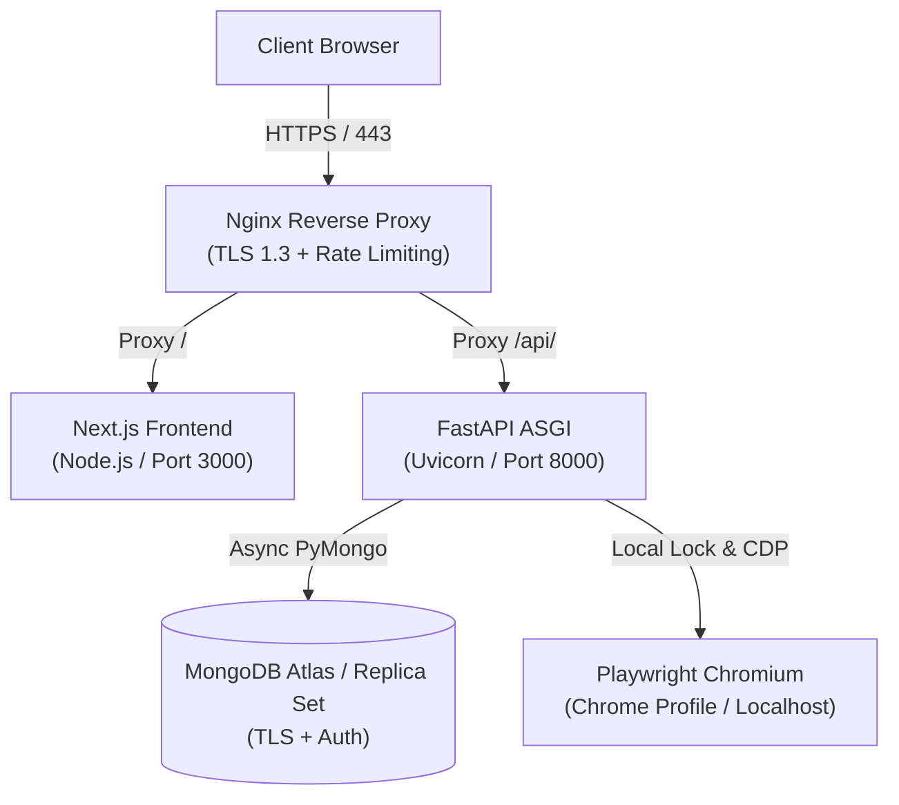

# RG AI — Production Deployment & Operations Runbook

## 1. Architecture Overview

RG AI production topology consists of:
- **Reverse Proxy / SSL Termination**: Nginx 1.24+ with TLS 1.3, HTTP/2, brotli/gzip compression, and proxy caching.
- **Frontend Server**: Next.js 16 standalone Node.js server managed via systemd.
- **Backend API**: Python FastAPI ASGI server running under Uvicorn with multiple workers managed via systemd.
- **Automation Engine**: Playwright Chromium daemon executing locally with process locks and isolated profiles.
- **Database**: MongoDB 7.0+ replica set (or MongoDB Atlas) with TLS encryption and connection pooling.



---

## 2. Infrastructure Prerequisites

| Component | Minimum Specification | Recommended Specification |
| :--- | :--- | :--- |
| **OS** | Ubuntu 22.04 LTS or 24.04 LTS | Ubuntu 24.04 LTS (x86_64) |
| **CPU** | 2 vCPU | 4 vCPU |
| **RAM** | 4 GB | 8 GB |
| **Storage** | 30 GB SSD | 60 GB NVMe SSD |
| **Software** | Node.js 20.x, Python 3.12+, Nginx, Certbot | Node.js 20.18+, Python 3.12+, MongoDB 7.0+ |

---

## 3. Environment Configuration

### 3.1 Backend Configuration (`/opt/rg-ai/backend/.env`)

```ini
APP_NAME="RG AI - Indian Stock Market Platform"
APP_ENV=production
DEBUG=false
API_V1_PREFIX=/api/v1
HOST=127.0.0.1
PORT=8000

# Security Keys
SECRET_KEY="<GENERATE_USING: openssl rand -hex 32>"

# Production CORS
CORS_ORIGINS=["https://rg-ai.example.com"]

# MongoDB Configuration
MONGODB_URI="mongodb+srv://rg_ai_user:<SECURE_PASSWORD>@cluster0.mongodb.net/?retryWrites=true&w=majority&appName=rg-ai-prod"
MONGODB_DB_NAME=rg_ai_production
MONGODB_MIN_POOL_SIZE=10
MONGODB_MAX_POOL_SIZE=50
MONGODB_TIMEOUT_MS=5000

# Rate Limiter
RATE_LIMIT_MAX_REQUESTS=120
RATE_LIMIT_WINDOW_SECONDS=60

# Market Data
MARKET_DATA_PROVIDER=yahoo
MARKET_DATA_CACHE_TTL_SECONDS=60
```

### 3.2 Frontend Configuration (`/opt/rg-ai/frontend/.env.production`)

```ini
NEXT_PUBLIC_API_URL="https://rg-ai.example.com"
PORT=3000
NODE_ENV=production
```

---

## 4. Backend Deployment via Systemd

### 4.1 Install System Dependencies

```bash
sudo apt update && sudo apt install -y python3-venv python3-pip python3-dev build-essential
```

### 4.2 Setup Application Directory & Virtual Environment

```bash
sudo useradd -m -s /bin/bash rgai
sudo mkdir -p /opt/rg-ai
sudo chown -R rgai:rgai /opt/rg-ai

# Clone or copy codebase into /opt/rg-ai
# As rgai user:
cd /opt/rg-ai/backend
python3 -m venv .venv
source .venv/bin/activate
pip install --upgrade pip
pip install -r requirements.txt
playwright install chromium
```

### 4.3 Systemd Service Unit (`/etc/systemd/system/rg-ai-backend.service`)

Create `/etc/systemd/system/rg-ai-backend.service`:

```ini
[Unit]
Description=RG AI FastAPI Backend Service
After=network.target

[Service]
Type=simple
User=rgai
Group=rgai
WorkingDirectory=/opt/rg-ai/backend
EnvironmentFile=/opt/rg-ai/backend/.env
ExecStart=/opt/rg-ai/backend/.venv/bin/uvicorn app.main:app --host 127.0.0.1 --port 8000 --workers 4 --loop uvloop --http httptools --log-level info
Restart=always
RestartSec=5
LimitNOFILE=65535

[Install]
WantedBy=multi-user.target
```

Enable and start the service:
```bash
sudo systemctl daemon-reload
sudo systemctl enable rg-ai-backend
sudo systemctl start rg-ai-backend
sudo systemctl status rg-ai-backend
```

---

## 5. Frontend Deployment via Systemd

### 5.1 Build Next.js Production Bundle

```bash
cd /opt/rg-ai/frontend
npm ci
npm run build
```

### 5.2 Systemd Service Unit (`/etc/systemd/system/rg-ai-frontend.service`)

Create `/etc/systemd/system/rg-ai-frontend.service`:

```ini
[Unit]
Description=RG AI Next.js Frontend Service
After=network.target

[Service]
Type=simple
User=rgai
Group=rgai
WorkingDirectory=/opt/rg-ai/frontend
Environment=NODE_ENV=production
Environment=PORT=3000
ExecStart=/usr/bin/npm start
Restart=always
RestartSec=5
LimitNOFILE=65535

[Install]
WantedBy=multi-user.target
```

Enable and start the service:
```bash
sudo systemctl daemon-reload
sudo systemctl enable rg-ai-frontend
sudo systemctl start rg-ai-frontend
sudo systemctl status rg-ai-frontend
```

---

## 6. Nginx Reverse Proxy & SSL Configuration

### 6.1 Install Nginx & Certbot

```bash
sudo apt install -y nginx certbot python3-certbot-nginx
```

### 6.2 Nginx Site Configuration (`/etc/nginx/sites-available/rg-ai`)

```nginx
# Rate limiting zone: 20 requests/sec per IP, burst 30
limit_req_zone $binary_remote_addr zone=rg_ai_limit:10m rate=20r/s;

server {
    listen 80;
    server_name rg-ai.example.com;
    return 301 https://$host$request_uri;
}

server {
    listen 443 ssl http2;
    server_name rg-ai.example.com;

    # SSL Certificates (managed via Certbot)
    ssl_certificate /etc/letsencrypt/live/rg-ai.example.com/fullchain.pem;
    ssl_certificate_key /etc/letsencrypt/live/rg-ai.example.com/privkey.pem;

    # SSL Hardening (TLS 1.2 & 1.3 only)
    ssl_protocols TLSv1.2 TLSv1.3;
    ssl_prefer_server_ciphers on;
    ssl_ciphers ECDHE-ECDSA-AES128-GCM-SHA256:ECDHE-RSA-AES128-GCM-SHA256:ECDHE-ECDSA-AES256-GCM-SHA384:ECDHE-RSA-AES256-GCM-SHA384;
    ssl_session_timeout 1d;
    ssl_session_cache shared:SSL:10m;
    ssl_session_tickets off;

    # Gzip Compression
    gzip on;
    gzip_vary on;
    gzip_proxied any;
    gzip_comp_level 6;
    gzip_types text/plain text/css application/json application/javascript text/xml application/xml application/xml+rss text/javascript image/svg+xml;

    # Maximum client body size (matches backend limit)
    client_max_body_size 2M;

    # API Proxy Routing
    location /api/ {
        limit_req zone=rg_ai_limit burst=30 nodelay;
        proxy_pass http://127.0.0.1:8000;
        proxy_http_version 1.1;
        proxy_set_header Upgrade $http_upgrade;
        proxy_set_header Connection 'upgrade';
        proxy_set_header Host $host;
        proxy_set_header X-Real-IP $remote_addr;
        proxy_set_header X-Forwarded-For $proxy_add_x_forwarded_for;
        proxy_set_header X-Forwarded-Proto $scheme;
        proxy_read_timeout 120s;
        proxy_connect_timeout 10s;
    }

    # Frontend Static & SSR Routing
    location / {
        proxy_pass http://127.0.0.1:3000;
        proxy_http_version 1.1;
        proxy_set_header Upgrade $http_upgrade;
        proxy_set_header Connection 'upgrade';
        proxy_set_header Host $host;
        proxy_set_header X-Real-IP $remote_addr;
        proxy_set_header X-Forwarded-For $proxy_add_x_forwarded_for;
        proxy_set_header X-Forwarded-Proto $scheme;
    }
}
```

Enable site:
```bash
sudo ln -s /etc/nginx/sites-available/rg-ai /etc/nginx/sites-enabled/
sudo nginx -t
sudo systemctl reload nginx
```

Obtain Let's Encrypt certificate:
```bash
sudo certbot --nginx -d rg-ai.example.com
```

---

## 7. Health Probes & Monitoring

RG AI provides two native health endpoints:

1. **System Health Probe**:
   ```bash
   curl -s https://rg-ai.example.com/api/v1/health | jq .
   ```
   *Expected Response:*
   ```json
   {
     "status": "healthy",
     "app": "RG AI - Indian Stock Market Platform",
     "environment": "production"
   }
   ```

2. **Database Health & Latency Probe**:
   ```bash
   curl -s https://rg-ai.example.com/api/v1/system/database-health | jq .
   ```
   *Expected Response:*
   ```json
   {
     "success": true,
     "data": {
       "status": "healthy",
       "connected": true,
       "latency_ms": 1.45,
       "client_type": "pymongo_async",
       "collections": 12
     }
   }
   ```

---

## 8. Backup & Disaster Recovery

Refer to [BACKUP.md](file:///home/ritesh/Desktop/Projects%20Data/AI%20Stock%20Market/BACKUP.md) for full backup procedures.

Automated daily backup cron example (`/etc/cron.daily/rg-ai-backup`):
```bash
#!/bin/bash
set -e
TIMESTAMP=$(date +"%Y%m%d_%H%M%S")
BACKUP_DIR="/var/backups/rg-ai/$TIMESTAMP"
mkdir -p "$BACKUP_DIR"

# Backup MongoDB
mongodump --uri="$MONGODB_URI" --out="$BACKUP_DIR/mongo" --gzip

# Retention: Delete backups older than 14 days
find /var/backups/rg-ai -maxdepth 1 -type d -mtime +14 -exec rm -rf {} +
```
Ensure execution permissions:
```bash
sudo chmod +x /etc/cron.daily/rg-ai-backup
```
